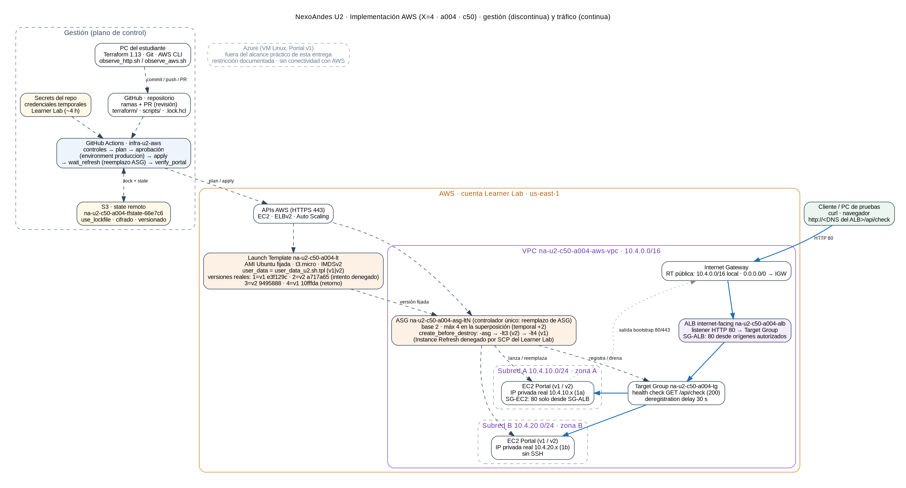
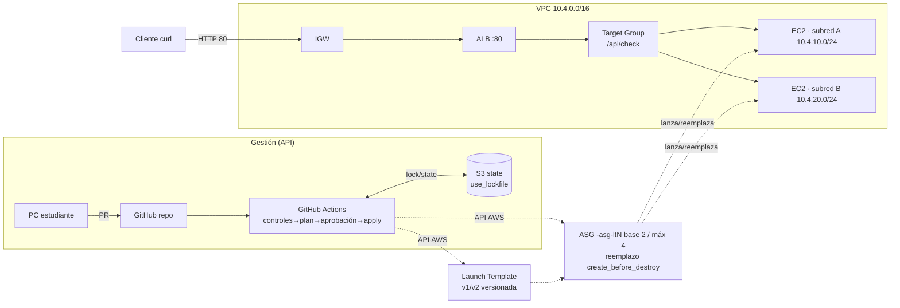

# NexoAndes U2 — Portal Operacional con infraestructura inmutable (AWS)

Evaluación Sumativa U2 · Automatización de Infraestructura con IaC (IC106TICL).
Identidad de laboratorio: **X=4 · alumno a004 · curso c50** · prefijo `na-u2-c50-a004`
(reemplazar por los valores asignados en `terraform/terraform.tfvars`).

## 1. Qué contiene

| Ruta | Contenido |
|---|---|
| `terraform/` | Orquestación root: `versions.tf`, `providers.tf`, `variables.tf`, `main.tf`, `outputs.tf`, `terraform.tfvars`, `.terraform.lock.hcl` |
| `terraform/modules/aws_network` | VPC 10.X.0.0/16, subred A 10.X.10.0/24 y B 10.X.20.0/24 en zonas distintas, IGW y rutas |
| `terraform/modules/aws_portal` | SG-ALB / SG-EC2, ALB + listener HTTP 80, Target Group (`/api/check`), Launch Template versionada (IMDSv2), ASG `-asg-ltN` reemplazado por versión (create_before_destroy) |
| `terraform/templates/user_data_u2.sh.tpl` | Artefacto docente del Portal (sin modificar), renderizado con `templatefile()` |
| `.github/workflows/infra-u2.yml` | Pipeline: controles → plan → aprobación (`produccion`) → apply → espera del controlador → verificación |
| `scripts/` | Observación (`observe_http.sh`, `observe_aws.sh`), análisis (`analyze_window.py`), consultas independientes (`capture_state.sh`, `refresh_times.sh`, `verify_cleanup.sh`), espera/verificación del pipeline, higiene y ZIP |
| `docs/` | Diagrama final (`arquitectura_u2_aws.png`; `arquitectura_u2_aws.dot` es el boceto Graphviz previo), plan de cambio (`plan_cambio_u2.md`), README docente |
| `evidencias/` | Registros de observación y consultas (revisados, sin secretos) |

## 2. Arquitectura





Gestión (líneas discontinuas) y tráfico (continuas) están separados: el pipeline nunca sirve el Portal;
el endpoint de servicio es el **DNS del ALB**, no la IP de una EC2.

**Azure:** el encargo contempla un Portal v1 en VM Linux. En esta entrega quedó **fuera del alcance
práctico** (restricción registrada en la bitácora de la Ficha). No existe conectividad, peering ni failover
entre nubes.

## 3. Decisiones principales

- **Estrategia (adaptada):** la estrategia planificada era rolling con *Instance Refresh*, pero la SCP de la
  cuenta del Learner Lab **deniega `autoscaling:StartInstanceRefresh`** (run 44933633166, ver bitácora y adenda §9
  de `docs/plan_cambio_u2.md`). Se implementó un **reemplazo inmutable del ASG**: el nombre del ASG incluye la
  versión de la Launch Template (`na-u2-c50-a004-asg-ltN`) y usa `create_before_destroy`; el ASG nuevo se registra
  en el mismo Target Group, Terraform espera 2 destinos healthy (`min_elb_capacity`) y solo entonces elimina el
  anterior. Capacidad base 2, temporal hasta +2 (4 durante la superposición).
- **Controlador único:** Terraform desde el pipeline (crear ASG nuevo → esperar → eliminar el anterior);
  `scripts/wait_refresh.sh` espera el resultado real (un solo ASG, destinos healthy en la versión nueva).
  Si el ASG nuevo no alcanza la capacidad, el apply falla y el anterior sigue atendiendo (detención automática).
- **Inmutabilidad:** cada versión del Portal es una versión nueva de la Launch Template (AMI fijada +
  bootstrap + `portal_version` + `build_ref`). No hay cambios manuales en instancias ni acceso SSH.
- **Persistencia:** el Portal no guarda datos de negocio; las instancias son reemplazables.
- **build_ref:** último commit que modificó `terraform/` (`git log -1 --format=%h -- terraform/`):
  cambios solo de documentación no reemplazan instancias.
- **State:** S3 remoto, cifrado, versionado y con bloqueo nativo (`use_lockfile`); fuera de Git.
- **Credenciales:** temporales del Learner Lab, como *secrets* del repositorio; nunca en el código.

## 4. Uso rápido

```bash
# Local (validación)
cd terraform
cp backend.hcl.example backend.hcl            # completar bucket real (no se versiona)
terraform init -backend-config=backend.hcl
terraform fmt -check -recursive && terraform validate
terraform plan -var "build_ref=$(git log -1 --format=%h -- .)"

# Observación de un cambio (desde la raíz del repo)
bash scripts/observe_http.sh "http://<DNS-ALB>" actualizacion_v2
bash scripts/observe_aws.sh  na-u2-c50-a004     actualizacion_v2
bash scripts/refresh_times.sh na-u2-c50-a004    # inicio/fin del reemplazo de ASG
python3 scripts/analyze_window.py --http evidencias/<...>_http.csv --aws evidencias/<...>_aws.csv \
  --start <InicioUTC> --stable <EstableUTC> --from-version v1 --target v2 \
  --student a004 --course c50 --x 4 --base 2 --out evidencias/analisis_v2.md
```

Los despliegues evaluados se ejecutan **solo por el pipeline** (merge a `main` o `workflow_dispatch`).

## 5. Referencias

- AWS — Instance refresh (estrategia planificada, denegada por SCP en el Learner Lab): https://docs.aws.amazon.com/autoscaling/ec2/userguide/asg-instance-refresh.html
- AWS — Service control policies: https://docs.aws.amazon.com/organizations/latest/userguide/orgs_manage_policies_scps.html
- Terraform — `create_before_destroy`: https://developer.hashicorp.com/terraform/language/meta-arguments/lifecycle
- AWS — User data e IMDSv2: https://docs.aws.amazon.com/AWSEC2/latest/UserGuide/user-data.html
- Terraform — `aws_autoscaling_group`: https://registry.terraform.io/providers/hashicorp/aws/latest/docs/resources/autoscaling_group
- Terraform — Backend S3 (`use_lockfile`): https://developer.hashicorp.com/terraform/language/backend/s3
- GitHub — Environments: https://docs.github.com/actions/deployment/targeting-different-environments/using-environments-for-deployment
